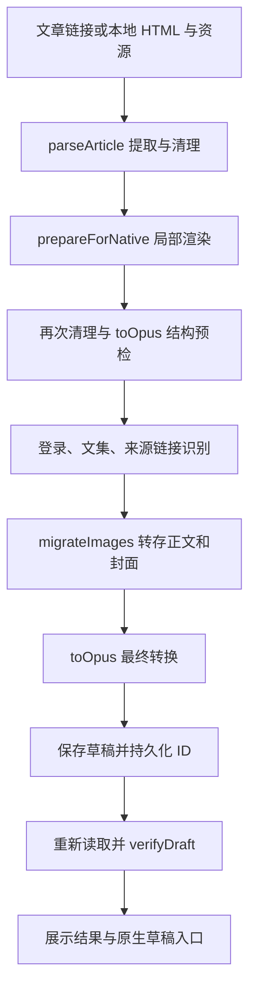

# 架构与维护导航

扩展在 B 站原生专栏编辑器中提供导入入口，把公众号 HTML 转为可编辑的 Opus 草稿。页面中编辑、预览与发布由 B 站负责。协议字段与官方代码依据见 [bilibili-protocol.md](bilibili-protocol.md)。

## 导入数据流



编排入口为 [native-controller.js](../extension/lib/native-controller.js) 的 `runImport({sourceUrl,html,localFiles}, onProgress)`。`File` 对象在内容脚本内处理，网络数据经 runtime 消息交给后台。结构预检在上传之前运行，使用临时图片元数据，不写入 B 站。

最终转换使用上传后的 CDN URL、真实图片元数据和来源链接识别结果。只要清理、局部渲染或转换返回 `blockingIssues`，就不保存不完整正文。

## 模块职责

| 模块 | 入口 / 负责内容 | 主要测试 |
| --- | --- | --- |
| [native-ui.js](../extension/native-ui.js) | Shadow DOM 导入框、来源输入、文件选择、忙碌状态、结果分级、恢复与下载按钮；动态导入 controller | `native-ui.test.js` |
| [native-controller.js](../extension/lib/native-controller.js) | `runImport`、`resetPendingImport`；编排解析、预检、媒体、匹配、保存 | `native-controller.test.js` |
| [article.js](../extension/lib/article.js) | `parseArticle`、`cleanArticle`；标题、封面、合集、正文、清理统计、本地资源映射 | `article.test.js` |
| [source-metadata.js](../extension/lib/source-metadata.js) | `scriptAlbumTitles`；从脚本文字的限定对象字面量读取栏目名，不执行源脚本 | `source-metadata.test.js` |
| [source-links.js](../extension/lib/source-links.js) | `normalizeSourceLink`；规范绝对 HTTP(S) 出处 URL | `source-links.test.js` |
| [local-files.js](../extension/lib/local-files.js) | 本地目录索引、路径解码、网页资源匹配 | `local-files.test.js` |
| [raster.js](../extension/lib/raster.js) | `findRasterTargets`、`prepareForNative`；局部复杂排版 → PNG | `raster.test.js` |
| [media.js](../extension/lib/media.js) | `downloadImage`、`migrateImages`；文件头、尺寸、哈希、去重、上传、动画核对 | `media.test.js` |
| [opus.js](../extension/lib/opus.js) | `toOpus`；原生节点、公式、图注、来源链接、样式适配 | `opus.test.js` |
| [bridge.js](../extension/lib/bridge.js) | `createBridgeClient`、`bridgeFetch`；类型受限的 runtime 请求与图片 Base64 传输 | `bridge.test.js` |
| [background-handlers.js](../extension/lib/background-handlers.js) | 消息来源校验、方法白名单、保存互斥、检查点与只读恢复 | `bridge.test.js`、`native-controller.test.js` |
| [background.js](../extension/background.js) | action / 页面路由、文章读取、草稿新页、封面下载、API 请求头规则 | `background-route.test.js` |
| [bilibili.js](../extension/lib/bilibili.js) | 协议客户端、payload、上传、链接识别、保存与读回 | `bilibili.test.js` |
| [import-notices.js](../extension/lib/import-notices.js) | `info/warning/error` 分类、去重、错误元数据保全 | `import-notices.test.js` |

## 页面与后台边界

[manifest.json](../extension/manifest.json) 在 `member.bilibili.com` 注入静态脚本，以支持站内 SPA 路由；`native-ui.js` 只在 `/york/read-editor`、`/platform/upload/text/new-edit` 和 `/platform/upload/text/edit` 激活控件。模块通过受该站点限制的 `web_accessible_resources` 加载。

运行特权操作前，后台同时检查扩展 ID、顶层 frame、发送页面和 tab URL。内容脚本不通过 `window.postMessage` 暴露调用入口。B 站 cookie、CSRF 与带会话 API 请求留在 service worker。

| 消息 | 方向与用途 |
| --- | --- |
| `SHOW_IMPORT` | action → 内容脚本；只打开输入框，可预填公众号链接 |
| `LOAD_ARTICLE` | 内容脚本 → 后台；优先读取已经打开的同 URL 公众号 tab，否则下载 HTML |
| `DOWNLOAD_IMAGE` | 内容脚本 → 后台；白名单图片来源的 GET，请求与返回跳转地址均校验 |
| `BILI_API` | 内容脚本 → 后台；只允许登录、文集、来源识别、图片上传和保存草稿方法 |
| `OPEN_SAVED_DRAFT` | 内容脚本 → 后台；验证编辑地址后新开草稿 tab |
| `DOWNLOAD_COVER` | 内容脚本 → 后台；复用已转存封面 URL，经原生下载对话框保存 |

`bridgeFetch` 只支持 GET 图片。Bridge 单张传输上限为 32MiB；`media.js` 的独立下载上限为 50MiB，走 bridge 时先受 32MiB 限制。CDN 图片读取不携带账号凭据。来源链接识别只请求 B 站官方接口，不访问该链接目标。

## 清理与样式策略

清理规则属于 [article.js](../extension/lib/article.js)，平台表达规则属于 [opus.js](../extension/lib/opus.js)。修改前先确定问题发生在哪一层，避免以更宽的读回归一化掩盖前面的转换错误。

- 提取正文后清除脚本、事件属性、隐藏组件、空占位与冗余空行。正文内有意义的单个换行继续保留。
- 普通锚点解包，保留说明文字和图片，并清除非出处正文中的裸 URL。只有符合独立出处段结构的安全 URL 才带 `data-sync-source-link="true"`；转换与后台再次验证它。
- `trimTail` 处理回顾、热门、投票、福利等尾部标题。需要上下文的标题使用结构与前置正文条件，避免误删正文中的同名词句。
- 灰色小字与单张图片关联为 `figure/figcaption`。复杂、强调、彩色或超长图注保持正文表达，不截断、不重复。
- 图片仅在存在明确装饰语义、且没有图注或其他内容证据时清理；不按图片 URL、数量或尺寸判断。未知叠层组合保留全部素材并标记局部渲染。容器底色清理依据正文/公式结构与对比度，保留行内高亮和可能承载信息的图像底色。
- CSS 简写与展开属性按同样语义处理。`background-image` 的空值、`none`、`initial`、`unset` 与实际图片分开；圆角、边框和间距按各边读取。JSDOM 与 Chromium 都有对应回归入口。
- 通用的透明到纯色半高渐变标记适配为原生高亮；安全的线性/径向渐变交给局部渲染。变量只读取源 DOM 的定义或显式回退值，未知变量及不支持的渐变形式保留问题提示，不能被外层截图掩盖。
- `opus.js` 将字体映射到原生档位，组合上下标为公式，保留可表达的文字强调。普通白色块级页面背景不变成逐字高亮；局部白底或覆盖彩底保留其语义。
- `analyzeNativeTextBackgrounds()` 由原生转换和局部渲染共享，按独立标题结构、纯色背景、统一浅色文字和对比度判断能否改为背景色加粗文字。不匹配文章文案或指定颜色；正文中的行内重点及需要完整底色的公式由最小局部渲染保留。

`toOpus()` 返回 `content`、`stats`、`summary`、`warnings`、`notices`、`blockingIssues`、`requestedSourceLinks` 和 `sourceLinks`。省略 `sourceLinkValidation` 仅用于预检；最终转换必须传 `{accepted,rejected,failed}`。`requestedSourceLinks` 用于识别请求，`sourceLinks` 仅列出实际生成的原生链接，供适配器允许列表核对。不能原生表达的出处样式或平台未认可的网址保留原文内容与完整可复制 URL。

### 局部渲染

`findRasterTargets()` 选择互不重叠的复杂表格、无源码图形、背景排版、叠层组合或行内位图。可原生表达的 LaTeX 公式继续走原生公式；需要完整底色的公式只转换所在段落。只有源码而没有可见内容的公式不能直接截图。独立图片不重新绘制。

`prepareForNative()` 在副本中加载图片、等待字体和解码，再由本地 html2canvas 生成 PNG，完成后才替换源节点。叠层 Grid 使用浏览器实际测量的子元素矩形固定局部布局，保留遮挡顺序，不依赖某一套模板的尺寸。

渲染使用 680px 布局宽、2 倍输出，限制单块高度与总像素。负边距溢出与 flex 绘制次序在渲染层处理。含动图的局部不能转成静态图片；输出问题进入 `blockingIssues`。局部转图会保留可视内容，但这些局部以后通过替换图片修改，因此提示等级为 warning。

这些渲染尺寸、资源上限和内容识别阈值属于插件策略，与 B站协议字段分开维护。规则验证采用不同文案、图片地址、颜色和尺寸的变体，具体要求见 [testing.md](testing.md)。

## 媒体与文集

`migrateImages()` 对正文图片与封面统一去重，以源文件 SHA-256 和账号区分上传缓存。相同图片出现多次只上传一次，正文出现顺序和次数不变。`mime`、`bytes` 与服务端 `size` 分别保留；GIF/WebP/APNG 动画检查与静态图片尺寸检查在媒体层完成。

文集优先取明确的来源栏目名；缺少元数据时才用标题末尾分隔标签。名称经 NFKC 和空白规范化后匹配，精确结果优先；`matchCollection()` 另有显式别名表。歧义或未匹配保留为空并提示，不使用子串猜测。

## 保存、恢复与验证

持久状态存入 `chrome.storage.local`：

| 键 | 内容与生命周期 |
| --- | --- |
| `pendingJob:<sourceKey>` | 当前来源的 `jobKey` 与开始时间；完整核验成功后移除 |
| `uploadCache:<userId>` | 内容哈希到上传结果的映射；当前保留最近 1500 项 |
| `draftCheckpoint:<userId>:<jobKey>` | 已确认草稿 ID、编辑地址和保存状态；获得 ID 后、读回前写入 |

`sourceKey` 取规范来源 URL 的 SHA-256；没有来源 URL 时用标题与清理后的 HTML。后台按账号和任务设置保存锁。

有已确认草稿 ID 的恢复只读取、核对并返回已有稿，不覆盖原生编辑器中的后续修改。创建请求网络中断或返回成功但没有有效 ID 时，记录 `saveUncertain`；需要先检查草稿箱，再由明确的恢复操作重置 pending job。`resetPendingImport()` 不从当前页面 URL 推断要更新的草稿。

`saveDraft()` 的顺序是保存 → 检查点 → GET 读回 → `verifyDraft()`。读取失败仍返回已保存的 ID 与 `verified:false`，UI 展示已有草稿入口。自动打开仅用于 `verified:true` 且没有 error 的结果；打开新 tab，不替换正在编辑的内容。校验的字段与允许归一化形式见协议参考。

`info` 表示确定的清理或原生适配；`warning` 表示局部转图、图注/链接回退、未匹配文集等需要查看的结果；保存失败和未通过核验属于 `error`。新代码优先返回结构化 `{severity,message}`，未知旧字符串默认保留为 warning。

## 定位与验证路径

| 问题 | 起点 | 先跑的测试 |
| --- | --- | --- |
| 缺字、剪尾、来源或图注关联 | `article.js`，对比清理前后 DOM | `article.test.js`、`source-metadata.test.js` |
| 换行、字号、公式、颜色 | `opus.js`，对比生成的节点 | `opus.test.js` |
| 缺图、上传错误、动图变化 | `media.js` → `bilibili.js` | `media.test.js`、`bilibili.test.js` |
| 局部截图截断、背景错误 | `raster.js` | `raster.test.js`，再浏览器渲染页 |
| 来源 URL 丢失或点击被移除 | `article.js` → `validateSourceLinks` → `toOpus` | `source-links.test.js`、`native-controller.test.js` |
| 重复草稿、已有稿被修改 | 检查 controller pending job 与后台 checkpoint | `native-controller.test.js`、`bridge.test.js` |
| 控件或路由问题 | `native-ui.js`、`background.js` | `native-ui.test.js`、`background-route.test.js` |
| 误报正文变化 | 保存预期与 API 读回，逐字段定位 | `bilibili.test.js`；有本地材料时加 `bilibili-live.test.js` |

常用检查为 `npm test`、`npm run check`。结构集成测试使用模拟媒体/保存结果；`tests/browser/` 提供 Chromium 中的清理、渲染和 UI 入口，`browser-runtime.test.js` 校验本地预览桩。`real-articles.test.js`、`real-opus.test.js` 和 `bilibili-live.test.js` 可使用未随仓库附带的本地材料，缺少时跳过。

从仓库根目录启动浏览器测试服务：

```sh
node scripts/serve.mjs
```

服务默认只监听 `127.0.0.1:43127`，可用环境变量 `PREVIEW_PORT` 改端口。打开以下实际入口：

| 地址 | 操作与覆盖范围 |
| --- | --- |
| `http://127.0.0.1:43127/__test__/browser.html` | 点击「测试局部图片转换」，检查背景与行内图文的局部渲染 |
| `http://127.0.0.1:43127/__test__/browser.html?scenario=success` | 操作导入框；真实 controller 配合内存媒体与保存结果，不连接 B 站；另有 `warning`、`error` 场景 |
| `http://127.0.0.1:43127/__test__/decorated-heading.html` | 点击测试按钮，检查低层渲染的负边距溢出、圆角与居中；该页不经过默认装饰清理 |
| `http://127.0.0.1:43127/__test__/article-regression.html` | 点击「检查本地样稿」，在 Chromium 中检查清理、CSSOM 和原生节点；图片上传与局部输出使用模拟结果 |
| `http://127.0.0.1:43127/__test__/generalization.html` | 点击「运行检查」，验证不同内容的标题适配、叠层图片像素和完整文字底色；使用本地合成内容 |

文章回归页从 `/__test__/private-samples.json` 读取本地文件 `test-artifacts/browser-article-fixtures.json`。该文件位于忽略目录，需自行准备，格式为 `[{"name":"样稿名称","html":"完整 HTML 字符串"}]`；`html` 是内容，不是文件路径。可从同样被忽略的 `测试文章/` 中读取保存网页来生成清单。缺少清单时页面会提示缺少材料；页面不下载外部图片，也不执行上传或草稿保存。

改动布局或 CSSOM 处理时，在浏览器页核对实际显示；改动远端字段时，在可用测试账号中保存并重新打开草稿，比较 API 节点与可见结果。两者都不能仅由 JSDOM 结构测试替代。
